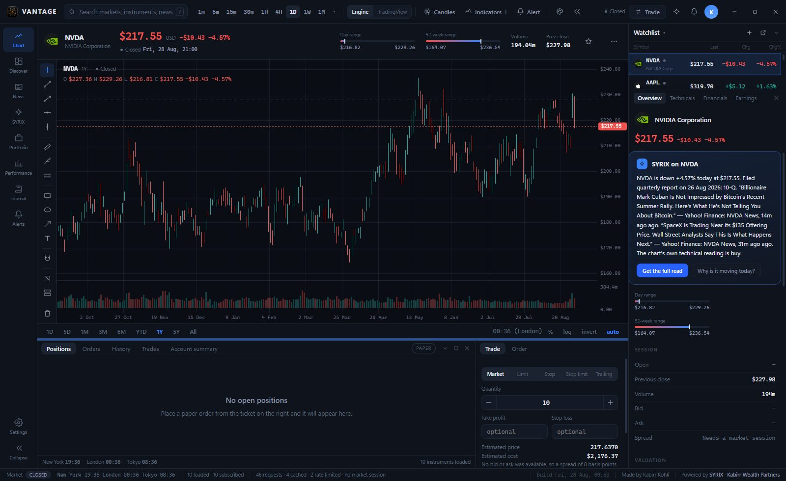
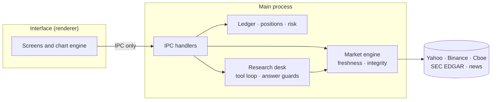

<p align="center">
  
</p>

<h1 align="center">VANTAGE</h1>

<p align="center">
  <b>A multi-asset research and paper-trading terminal for Windows.</b><br>
  Equities · futures · FX · indices · crypto — charting, filings, news, a portfolio ledger and an AI research desk in one window.
</p>

<p align="center">
  JavaScript · Electron · Canvas 2D · zero npm dependencies<br>
  <a href="https://kabirr-kohli.pages.dev/vantage">Project page</a> ·
  <a href="https://kabirr-kohli.pages.dev">Portfolio</a>
</p>

<br>



## Why it exists

VANTAGE started as my own trading records and grew into the tool I wanted instead of switching between a charting site, a broker, a filings website and a spreadsheet. It is built around one rule: **a number on screen must be as trustworthy as its source, and say so when it is not.** Nothing is labelled live unless the venue says it is, a figure that fails an integrity check is not shown at all, and every total carries the freshness of the oldest thing inside it.

## Highlights

| | |
|---|---|
| **Charting** | A canvas chart engine written from scratch — candles, line and volume series, indicators, and drawing tools anchored to time and price, so a line stays on its bar across timeframes and window sizes. Bar sizes from one second to one month |
| **Market data** | Quotes, history, options and fundamentals from free public sources: Yahoo Finance, Binance, Cboe and SEC EDGAR, with company accounts read straight from XBRL filings |
| **Paper trading** | Market, limit, stop, stop-limit and trailing orders against a simulated broker, with take-profit and stop-loss |
| **Portfolio and journal** | Positions derived from a transaction ledger, never stored. Real, paper and imported holdings are separate books that are never added together |
| **Research desk** | SYRIX answers with live prices, filings, news and web search; the reply passes guards that strip unsupported advice and flag figures that match no source |
| **News and discovery** | Worldwide news search, an in-app reader, sector heatmaps, a screener and an economic calendar |

## How it is put together



The interface makes **no network requests at all** — its Content Security Policy is `connect-src 'none'`, enforced at the session level and checked by an architecture test. Every fetch, every provider and every model call lives in the main process, so a compromised page has no way out.

## Engineering notes

A few of the problems that shaped the code, each now pinned by a test:

- **"Daily" history that was secretly monthly.** Yahoo answers `range=max&interval=1d` with *monthly* bars and no warning. The adapter reads back `meta.dataGranularity`, labels what was really served, and requests true long daily history by date range instead.
- **A look-ahead leak in the replay engine.** `Number(null)` is `0`, so a missing replay cursor became "cut off at 1970" and admitted the earliest bar. The cutoff now uses a strict number parser — in the one function the replay engine and the backtester both depend on.
- **Fifteen frames a second on long charts.** Building an `Intl.DateTimeFormat` per bar to find session boundaries made panning a 1,500-bar chart run at about fifteen frames a second. Formatters are cached per time zone, and the chart never draws more candles than there are pixel columns: runs of bars merge into one candle (first open, last close, true extremes) with an identical picture.
- **Timeframes mean candle size, not look-back.** Every bar size loads the full history the source publishes at that size; the `1D 5D 1M … All` strip zooms over what is loaded rather than fetching.
- **Freshness is earned.** A feed that declares no delay is treated as delayed; an undeclared feed gets a 45-minute allowance before it is called stale, because thinly traded futures legitimately gap that long.

## Tests

```
node tests/run-all.js      # 1,623 assertions across 12 suites, no window opened
node tests/ui-probe.js     # drives the running app over the Chrome DevTools Protocol
```

The interface probe launches its own copy of the app on a throwaway data directory and checks every screen, both themes, chart interaction, drawing anchors and the wiring of every control.

## Repository layout

```
main/        Electron main process, IPC, windows
src/
  core/      HTTP client, storage, audit log, PDF reader, branding
  market/    Instruments, candles, freshness, integrity, data providers
  paper/     Simulated broker
  portfolio/ Ledger, positions, valuation, risk, journal
  analysis/  Technical indicators
  syrix/     Research desk: gateway, tool loop, evidence and answer guards
web/         Interface: screens, chart engine, drawing tools, styles
tests/       Unit, architecture and live-interface suites
tools/       Launcher, icon generator, inspection and screenshot tools
```

## Running it

Requires Node.js 18+ and Electron 31.

```
npx electron@31.7.7 .
```

Optional settings, read from the environment:

| Variable | Purpose |
|---|---|
| `VANTAGE_CONTACT` | Contact address sent in the User-Agent (required by SEC EDGAR) |
| `SYRIX_GATEWAY_URL` | Address of the research desk's model gateway |
| `TERMINAL_DATA_DIR` | Where records are stored (defaults to `./data`) |

The research desk pairs once with `node tools/pair-syrix.js <pairing-code>` and keeps only a revocable device token — no provider API key is ever held by the app. Paper trading only: VANTAGE places no real orders.

## Development history

Developed in a private repository — 22 commits, August 2026 — and published here as a curated snapshot. The working history stays private because it contains local configuration from development.

---

<p align="center"><sub>© 2026 Kabirr Kohli. All rights reserved. Published for viewing; no licence is granted to copy, modify or redistribute.</sub></p>
